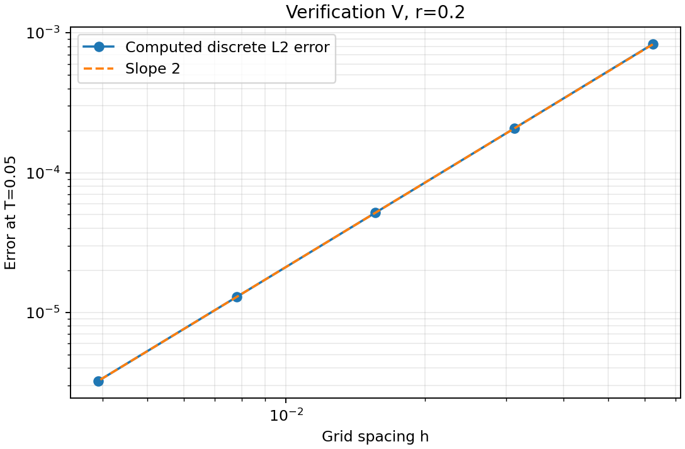
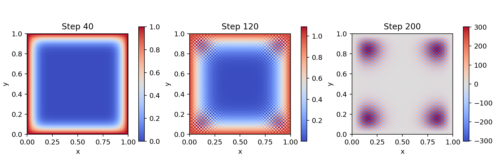
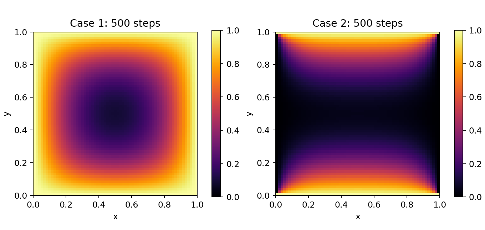

# Part 1: serial heat solver verification and analysis

## Outcome and provenance

Part 1 technical verification is complete. All six correctness test groups passed
on heat-1 Ubuntu. The five-grid convergence study, deliberate instability
demonstration and stable Cases 1/2 completed successfully. The actual Ubuntu
CSVs, raw command output, source metadata and figures were then inspected.

The primary study was generated at **2026-11-19 16:16:15 UTC** on Linux x86_64.
[Metadata](results/2026-11-19-ubuntu/metadata.json) records the exact solver source
hash, which matches `heat_serial.cpp`. The [manifest](results/2026-11-19-ubuntu/manifest.json)
records original file hashes and the archive hash. These are user-collected
results, independently checked after transfer; they are not a new cluster run
performed during publication. Original measurements are preserved.

## Numerical method

The unit square has alpha=1, N intervals per direction, spacing h=1/N and
(N+1)^2 stored nodes including the boundary. Forward Euler in time and centred
second differences in space give the five-point update

$$
u^{n+1}_{i,j}=u^n_{i,j}+r\left(u^n_{i-1,j}+u^n_{i+1,j}
+u^n_{i,j-1}+u^n_{i,j+1}-4u^n_{i,j}\right),
\qquad r=\Delta t/h^2.
$$

The implementation uses contiguous old/next vectors, one row-major indexing
function, and buffer swaps after each step. Boundaries are initialized in both
arrays and only interior nodes are updated. The neighbour-sum order is fixed
and floating-point contraction is disabled for the later serial/MPI comparisons.

The centre weight is 1-4r and the four neighbour weights are r. They sum to one
and are nonnegative for 0<=r<=1/4, giving a discrete maximum principle. Fourier
analysis gives the same standard 2D stability limit. Ordinary program runs
require positive r<=1/4; the deliberate experiment has a separate explicit flag.

For a requested final time, steps=ceil(T/(r*h^2)), then dt=T/steps, with a rounding
guard so the effective r does not exceed the requested value. With fixed steps,
dt=r*h^2. Timing covers only the loop and swaps; setup, norms and output are
outside it. Compilation uses C++17, O2 and ffp-contract=off.

## Convergence: verification V

The initial field is sin(pi*x)sin(pi*y), with zero Dirichlet boundaries. The
exact solution is sin(pi*x)sin(pi*y)exp(-2*pi^2*t). The archived study uses
T=0.05, r=0.2 and all five required grids.

The maximum error is max(abs(e)). The discrete L2 error is
h*sqrt(sum(e^2)), including the grid weighting. The observed order compares
consecutive grids using log2(E_coarse/E_fine).

| N | h | Steps | Maximum error | Discrete L2 error | Observed order |
| ---: | ---: | ---: | ---: | ---: | ---: |
| 16 | 0.0625 | 64 | 1.66337050e-3 | 8.31685252e-4 | -- |
| 32 | 0.03125 | 256 | 4.14182427e-4 | 2.07091213e-4 | 2.00577 |
| 64 | 0.015625 | 1024 | 1.03442488e-4 | 5.17212439e-5 | 2.00144 |
| 128 | 0.0078125 | 4096 | 2.58541870e-5 | 1.29270935e-5 | 2.00036 |
| 256 | 0.00390625 | 16384 | 6.46314472e-6 | 3.23157236e-6 | 2.00009 |

Source: [unchanged Ubuntu convergence.csv](results/2026-11-19-ubuntu/convergence.csv).

The errors decrease by approximately four whenever h halves; the orders
approach two. This is the expected overall order: the method has O(dt)+O(h^2)
error, and fixed r makes dt proportional to h^2. Forward Euler remains first
order in time; the chosen refinement path gives overall second order in h.

An independent check uses the discrete sine-mode amplification
G_N=1-8r*sin(pi/(2N))^2. After M steps the numerical amplitude is G_N^M.
For these even grids, the expected maximum error is
abs(G_N^M-exp(-2*pi^2*T)), and the discrete L2 error is exactly half that value
in exact arithmetic. Both archived norms agree with these predictions within
5e-13 absolute tolerance. Raw solver outputs also agree with the CSV entries.

## Deliberate instability: Task 6.7

Case 1 starts with a cold interior and four hot edges. At N=64 the normal bound
is dt<=1/(4*64^2). The demo uses r=0.2625, exactly 5% above 0.25, and explicit
fixed-step snapshots. The ordinary stability guard is retained for normal runs.

| Steps | Simulated time | Minimum | Maximum |
| ---: | ---: | ---: | ---: |
| 40 | 0.0025634765625 | 4.14117e-13 | 1.00000 |
| 120 | 0.0076904296875 | 0.000206809 | 1.08997 |
| 200 | 0.0128173828125 | -303.12495 | 302.30701 |

Source: [unchanged instability.csv](results/2026-11-19-ubuntu/instability.csv).

The early snapshot looks plausible, but overshoot is visible by step 120 and
large positive/negative oscillations dominate by step 200. Boundary values
remain one. The visible checkerboard near the heated corner regions agrees
with the stability-limiting high-frequency mode. Its ideal Fourier factor is
1-8r=-1.1: it reverses sign and grows in magnitude each step. On the finite
Dirichlet grid the highest sine mode has a slightly different factor, still
unstable. Each panel has its own colour scale, so the extrema table is essential
when comparing the growth.

## Stable Cases 1 and 2

Both runs use N=64, r=0.2, 500 steps, giving T=0.0244140625.
Case 1 holds all four edges at one. Case 2 holds top/bottom at one, including
corners, and the remaining left/right boundary nodes at zero.

Both fields remain within [0,1], keep the prescribed boundaries and preserve
horizontal/vertical reflection symmetry. Case 1's minimum is approximately
0.0925825 and maximum one; Case 2's range is [0,1]. These are transient fields:
Case 1 warms towards uniform one, while Case 2 approaches a nonuniform steady
field determined by its hot and cold edges.

All five binary snapshots were checked for exact size (33800 bytes for 65x65
doubles), finite values and fixed boundaries. Stable snapshots passed symmetry
and bound checks. The five boundary-heated snapshots are also byte-identical
to the earlier Windows outputs for the same inputs. This cross-check is not
MPI correctness evidence; serial/strips/blocks comparisons remain later work.

## Delivery and reproducibility

The [delivery checklist](DELIVERY.md) links the sources and all evidence.
`make check-serial` reruns the six correctness groups. `make verify-part1`
creates a fresh study directory; `make verify-part1-results` checks the archived
Ubuntu evidence without running the solver. The latter also checks hashes,
source provenance, raw/CSV consistency and the independent modal predictions.

Loop timings in raw output are single incidental measurements. Controlled
repeated performance/scaling experiments belong to Part 4; no speed-up or
network crossover conclusion is drawn from this study.

Requirements and derivations follow the supplied [project specification](../docs/assignment/heat_mpi_project.pdf)
and [numerical background](../docs/assignment/heat_numerics_background.pdf).
The separate [written task solutions](../docs/background-solutions/README.md)
include the derivations and nonoptional background exercises.
