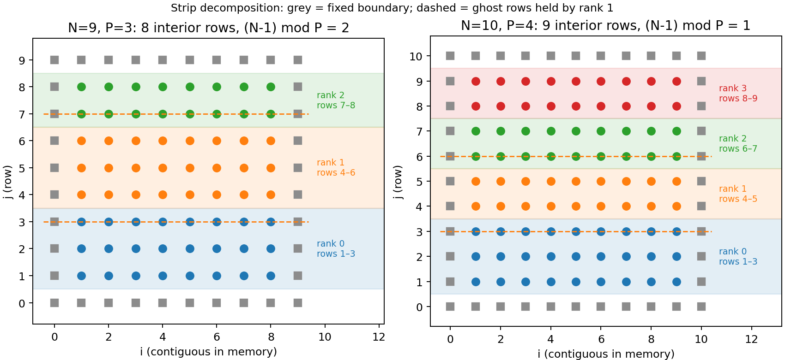
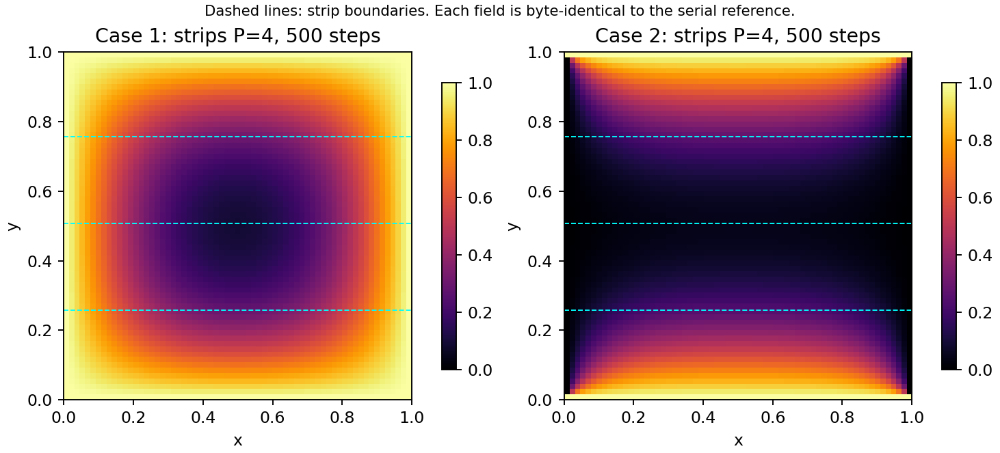

# Part 2: strip decomposition, correctness argument and expected cost

## Outcome and provenance

**Status: complete; checkpoint C2 reached.** The [primary cluster study](results/2026-11-19-cluster/)
was launched from heat-3 at 2026-11-19 18:49:15 UTC. It ran the executables built from commit 1c2b5e6
on all three VMs, and the source hashes in its metadata match the committed files. In it:

- the six correctness groups passed;
- **84 of 84** serial-vs-strips comparisons were byte-identical, covering P = 1–4, seven
  values of N and uneven strips;
- every multi-process run spanned two or three VMs.

The archive was re-verified after transfer and reviewed (`review.json`).

Before any MPI run, the decomposition logic had been checked by an exact Python emulation
of the row split, ghost layout, two-shift exchange and gather. It produced 96/96 fields
byte-identical to an emulated serial loop. That emulation was a design check only. The
evidence is the cluster study.

## Decomposition

The (N+1)×(N+1) grid keeps its row-major layout. The N−1 interior rows are cut into
P contiguous strips (assignment section 6.1):

$$
n_p=\left\lfloor\frac{N-1}{P}\right\rfloor+[\,p<(N-1)\bmod P\,],\qquad
j^{\text{first}}_p = 1+p\left\lfloor\frac{N-1}{P}\right\rfloor+\min\bigl(p,(N-1)\bmod P\bigr).
$$

Rank p stores np+2 rows: its owned rows plus one ghost row below and above.
For rank 0 and rank P−1 the outer ghost row *is* the plate's Dirichlet row (j=0 or
j=N). It is filled once and never overwritten, because the matching neighbour is
`MPI_PROC_NULL`. The run's `decomposition.png` figure shows the layout for
N=9, P=3 (strips of 3, 3, 2 rows) and N=10, P=4 (3, 2, 2, 2).

## Why the output is bit-for-bit identical to serial

The explicit update for an interior node,

$$
u^{n+1}_{i,j}=u^n_{i,j}+r\left(\bigl((u^n_{i-1,j}+u^n_{i+1,j})+u^n_{i,j-1}\bigr)+u^n_{i,j+1}-4u^n_{i,j}\right),
$$

reads only level-n values from the node and its four neighbours. After the halo
exchange, every rank holds exactly those level-n values for each of its owned nodes:

- the nodes in its own rows;
- the neighbour's edge row, in the ghost row;
- or the fixed boundary row.

The C++ expression, the parenthesisation and the compiler flags (`-O2 -ffp-contract=off`)
are the same as in the serial reference. Each node therefore undergoes identical IEEE-754
operations on identical inputs, so its result is identical. By induction over the steps,
the whole field matches bit for bit for every P, and the gathered file is the same file.

The same argument covers the V-case error norms. They are computed on rank 0 from the
gathered field in the serial loop order, so the reduction order does not change.
Minimum and maximum are combined with `MPI_MIN`/`MPI_MAX`, which involve no rounding.

What the argument needs, and what the tests check (see [DELIVERY.md](DELIVERY.md)):

1. the strips tile rows 1..N−1 exactly once (row-size test, gather offsets);
2. every ghost row equals the neighbour's current edge row before each update (debug test);
3. the boundary rows stay fixed in both buffers (`MPI_PROC_NULL` and initial copy);
4. no rank uses a level-(n+1) value during step n (two arrays and a swap, as in Part 1).

## Halo exchange and deadlock

Each step performs two `MPI_Sendrecv` shifts: top rows up / bottom ghosts from below,
then bottom rows down / top ghosts from above. Every rank takes part in both shifts at the
same time, so all neighbour pairs communicate in parallel and the exchange costs
about two message times whatever P is. Sending rows directly from the array works
because a row is contiguous: one message of N+1 doubles, with no packing.

A naive "blocking `MPI_Send` up, then `MPI_Recv`" works only while messages fit the
eager protocol. Above the eager limit `MPI_Send` waits for the matching receive.
Every rank waits in its send for a neighbour that is also waiting in its send, so
the program deadlocks. This explains "works for small N, hangs for large N". The
[README](README.md#why-a-blocking-send-then-recv-exchange-can-deadlock-report-question)
gives the Open MPI limits to check. `MPI_Sendrecv` progresses the send and the receive
together, so it cannot deadlock this way.

## Expected cost: a prediction from Part 0 and Part 1 data

Per step, a middle strip computes about (N−1)²/P updates and exchanges two rows of
8(N+1) bytes. With the Part 0 message model tmsg(m)=ts+m/B and the
paired-exchange convention of background Task 8.2(c):

$$
T_P \approx c\,\frac{(N-1)^2}{P} + 2\left(t_s+\frac{8(N+1)}{B}\right).
$$

Inputs come from archived evidence, not Part 2 runs:

- c ≈ 1.2 ns per node update, from the incidental Part 1 loop timings on heat-1
  (1.0–1.3 ns over the five convergence grids);
- ts and B come from the Part 0 summary table.

| N | serial step | link (Part 0) | modelled comm / step | modelled P=4 step | modelled speed-up |
| ---: | ---: | --- | ---: | ---: | ---: |
| 512 | 0.31 ms | same VM, ts=0.26 µs, 5830 MiB/s | 0.002 ms | 0.08 ms | 3.9 |
| 512 | 0.31 ms | heat1–heat2, ts=17.7 ms, 0.144 MiB/s | 90 ms | 90 ms | 0.003 |
| 2048 | 5.0 ms | same VM | 0.006 ms | 1.26 ms | 4.0 |
| 2048 | 5.0 ms | heat1–heat2 | 253 ms | 254 ms | 0.02 |
| 8192 | 81 ms | same VM | 0.02 ms | 20 ms | 4.0 |
| 8192 | 81 ms | heat1–heat2 | 904 ms | 924 ms | 0.09 |
| 8192 | 81 ms | heat2–heat3, ts=77.6 ms, 0.092 MiB/s | 1508 ms | 1528 ms | 0.05 |

What the model predicts:

- **Within one VM**, communication is negligible, and strips should approach ideal speed-up,
  limited in practice by the VM's two vCPUs and memory bandwidth.
- **Across VMs over Tailscale**, the halo exchange dominates for every grid in the assignment.
  The model predicts that spreading strips over machines makes each step tens to hundreds of
  times slower than one process.
- **Communication shrinks only relative to computation.** The ratio
  Tcomm/Tcomp ≈ 2P(ts+8N/B)/(cN²) falls as N grows.
  With these latencies it stays above 1 even at N=8192.

These numbers are an extrapolation. The Part 0 bandwidths came from one sweep per pair,
partly while routes changed between relay (DERP) and direct, and Part 1 timings were never
intended as performance data. Part 4 must measure tcomm and tcomp
directly (the solver already reports both, as maxima over ranks) and confront this model.

**Practical consequence for C2.** One cross-VM step costs roughly 0.1–0.5 s, so the
default comparison uses few steps (20 for Cases 1/2, T=0.002 for V). Correctness
needs only enough steps for information to cross several strip boundaries.

## Results

Source: [2026-11-19 cluster study](results/2026-11-19-cluster/), checked offline by
`make verify-part2-results`.

### Correctness: checkpoint C2

| | P = 1 | P = 2 | P = 3 | P = 4 |
| --- | ---: | ---: | ---: | ---: |
| Comparisons (Cases 1, 2, V × 7 values of N) | 21 | 21 | 21 | 21 |
| Byte-identical field file and summary values | 21 | 21 | 21 | 21 |
| Of which uneven strips, (N−1) mod P ≠ 0 | 0 | 12 | 12 | 12 |
| Machines used (`nodes`) | 1 | 2 | 3 | 3 |

N = 8, 9, 10, 16, 17, 64, 101. Cases 1/2 ran 20 steps and V ran to T = 0.002, all at r = 0.2.
Across all 84 comparisons, `cmp` would report no difference. Steps, r, dt, T, minimum,
maximum and the V error norms err_inf and err_l2 are also identical strings. This meets
C2: identical output for P = 1–4 and several N, including N−1 not divisible by P, across
at least two VMs. The six-group correctness suite, which includes ghost-row equality after
1, 2 and 5 steps and the unstable demo at r = 0.2625, passed on heat-3.

The halo-debug runs in `debug_halo.txt` (Case 2, N=8, one step) show the expected layout.
With P=2 the strips have 4 and 3 rows; with P=3 they have 3, 2 and 2. Each ghost row equals
the neighbour's owned row with the same j. Ranks 0 and P−1 hold the hot plate rows as
`boundary`. After one step the first interior row next to each hot edge equals r = 0.2,
the stencil value for a cold node with one hot neighbour.

The P=4, N=64, 500-step fields are byte-identical to the serial Part 1 fields. Those Part 1
fields were themselves checked for symmetry and bounds. No seam is visible at the strip
boundaries (dashed).

### Incidental timing: what one correctness run already shows

Each configuration ran once, to check correctness. These timers are therefore indicative,
not Part 4 measurements. Each value is the maximum over ranks, divided by the step count.

| P | machines | median tcomm per step | range | model, latency only |
| ---: | ---: | ---: | ---: | ---: |
| 1 | 1 | 0.000 ms | ≤ 0.001 ms | 0 |
| 2 | 2 | 107 ms | 72–288 ms | ≈ 120 ms |
| 3 | 3 | 138 ms | 64–537 ms | ≥ 120 ms |
| 4 | 3 | 214 ms | 73–616 ms | ≈ 155 ms |

The "model, latency only" column assumes `--map-by node` placement, which is not recorded
per rank. Rank 0 sits on heat-3 (the launcher), rank 1 on heat-1, rank 2 on heat-2 and
rank 3 on heat-3 again. With rows of at most 816 bytes the bandwidth term is negligible,
so a step costs about two message latencies on the slowest link involved. The Part 0
latencies are 60 ms for heat-3↔heat-1 and 77.6 ms for heat-2↔heat-3. The measured medians
have the same order of magnitude as these Part 0 latencies. The wide spread (64–616 ms) is
consistent with the variable Tailscale paths observed in Part 0, including relay periods.

In every multi-machine run, communication took **at least 99.98 %** of ttotal.
The figure runs make the cost concrete. Case 1 with P=4 and N=64 took **68.0 s** for
500 steps, of which only 0.0035 s was computation; Case 2 took 77.1 s. The serial solver
runs the same 500 steps in a few milliseconds. This confirms the model's main prediction:
over this network, strips are far slower than one process at these grid sizes, and the halo
latency alone dominates. Part 4 will measure this properly with repeated runs, larger N and
both placements, and test where (if anywhere) the crossover lies.
